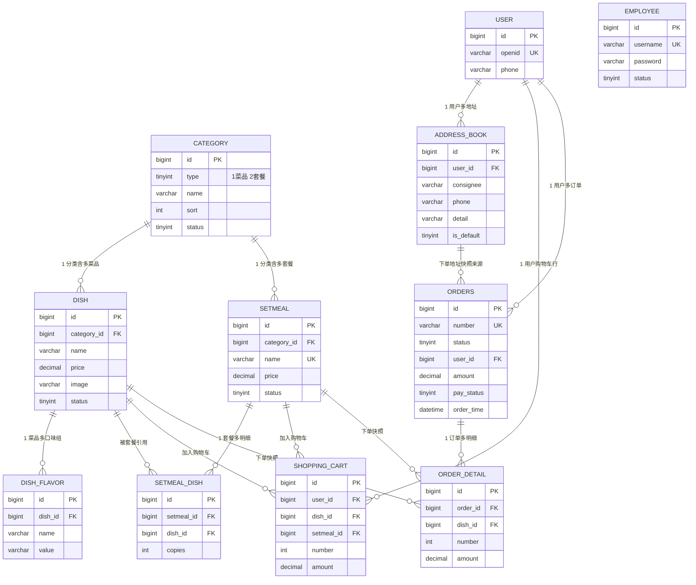

> **状态：组员第 1~3 周草案（已归档，勿作为依据）**
> 组长刘晟玺已交付正式版本，权威文件见 `docs/leader/week2/database-design.md`；本文件仅保留为过程留痕。
> 最新整合结果与实测证据见 `docs/integration/`（contract-diff / page-api-map / defects / integration-record）。
# 数据库设计：ER 图与数据字典

| 项目 | 内容 |
| --- | --- |
| 版本 | v0.3（评审版） |
| 整理 | 钱文博（组员）；后端实现与最终定稿由组长刘晟玺负责 |
| 依据 | `docs/database/schema.sql`、`docs/database/data.sql` |
| 状态 | **已在本机 MySQL 8.0.46 实测建表并导入种子数据**；字段增删待双方评审 |
| 日期 | 2026-10-26 |

- 库名：`donghua_shop`，字符集 `utf8mb4`，排序规则 `utf8mb4_general_ci`，引擎 InnoDB。
- 表名与字段命名对齐“苍穹外卖”参考素材，便于组长复用其 SQL 与 DTO/VO。
- 金额统一 `DECIMAL(10,2)`，时间统一 `DATETIME`，主键统一 `BIGINT AUTO_INCREMENT`。
- 只保留 `employee.status` 作为业务启用标记，不做逻辑删除；“是否删除”由各表的引用约束体现。

## 1 ER 图

> 说明：图中关系是**业务逻辑外键**，建表脚本未加 `FOREIGN KEY` 约束。
> 原因：课程内需要频繁清空/重灌种子数据，物理外键会显著增加脚本复杂度；约束完整性由 Service 层与评审用例保证（见 `review-notes.md` 第 3 条）。

## 2 数据字典

### 2.1 employee（员工）

| 字段 | 类型 | 允许空 | 默认 | 键/索引 | 说明 |
| --- | --- | --- | --- | --- | --- |
| id | BIGINT | 否 | AUTO_INCREMENT | PK | 主键 |
| name | VARCHAR(32) | 否 | — | — | 姓名 |
| username | VARCHAR(32) | 否 | — | UK `uk_employee_username` | 登录账号 |
| password | VARCHAR(64) | 否 | — | — | 密码散列（当前种子数据为 MD5，见评审意见 2） |
| phone | VARCHAR(11) | 否 | — | — | 手机号 |
| sex | CHAR(2) | 否 | '1' | — | 1 男 2 女 |
| id_number | VARCHAR(18) | 否 | — | — | 身份证号（课程数据，非真实） |
| status | TINYINT | 否 | 1 | — | 1 启用 0 禁用 |
| create_time | DATETIME | 否 | CURRENT_TIMESTAMP | — | 创建时间 |
| update_time | DATETIME | 否 | 自动更新 | — | 最后修改时间 |
| create_user | BIGINT | 否 | 1 | — | 创建人 id |
| update_user | BIGINT | 否 | 1 | — | 最后修改人 id |

### 2.2 category（分类）

| 字段 | 类型 | 允许空 | 默认 | 键/索引 | 说明 |
| --- | --- | --- | --- | --- | --- |
| id | BIGINT | 否 | AUTO_INCREMENT | PK | 主键 |
| type | TINYINT | 否 | — | `idx_category_type` | 1 菜品分类 2 套餐分类 |
| name | VARCHAR(32) | 否 | — | UK `uk_category_name_type`(name,type) | 名称，同类型内唯一 |
| sort | INT | 否 | 0 | — | 升序排序 |
| status | TINYINT | 否 | 1 | — | 1 启用 0 禁用 |
| create_time / update_time / create_user / update_user | 同上 | | | | 审计字段 |

### 2.3 dish（菜品）

| 字段 | 类型 | 允许空 | 默认 | 键/索引 | 说明 |
| --- | --- | --- | --- | --- | --- |
| id | BIGINT | 否 | AUTO_INCREMENT | PK | 主键 |
| name | VARCHAR(64) | 否 | — | `idx_dish_status_name`(status,name) | 菜品名称 |
| category_id | BIGINT | 否 | — | `idx_dish_category` | 所属菜品分类 |
| price | DECIMAL(10,2) | 否 | — | — | 单价（元） |
| image | VARCHAR(255) | 是 | NULL | — | 图片 URL，课程内允许为空 |
| description | VARCHAR(255) | 是 | NULL | — | 描述 |
| status | TINYINT | 否 | 1 | 见上 | 1 起售 0 停售 |
| create_time / update_time / create_user / update_user | 同上 | | | | 审计字段 |

### 2.4 dish_flavor（菜品口味）

| 字段 | 类型 | 允许空 | 说明 |
| --- | --- | --- | --- |
| id | BIGINT | 否 | 主键 |
| dish_id | BIGINT | 否 | 所属菜品，`idx_flavor_dish` |
| name | VARCHAR(32) | 否 | 口味组名，如“辣度” |
| value | VARCHAR(64) | 否 | 逗号分隔的可选值，如“不辣,微辣,中辣” |

> 与契约的差异：数据库用逗号串存储，`GET /dishes/{dishId}` 返回 `flavors[].values` 数组，由后端转换。
> 若后续需要“口味加价”，应拆成独立表，本期不做。

### 2.5 setmeal（套餐）

| 字段 | 类型 | 允许空 | 默认 | 键/索引 | 说明 |
| --- | --- | --- | --- | --- | --- |
| id | BIGINT | 否 | AUTO_INCREMENT | PK | 主键 |
| category_id | BIGINT | 否 | — | `idx_setmeal_category` | 必须是 `type=2` 的分类 |
| name | VARCHAR(64) | 否 | — | UK `uk_setmeal_name` | 套餐名称 |
| price | DECIMAL(10,2) | 否 | — | — | 套餐价（不等于明细之和） |
| status | TINYINT | 否 | 1 | — | 1 起售 0 停售 |
| description | VARCHAR(255) | 是 | NULL | — | 描述 |
| image | VARCHAR(255) | 是 | NULL | — | 图片 URL |
| 审计字段 | | | | | 同 dish |

### 2.6 setmeal_dish（套餐明细）

| 字段 | 类型 | 允许空 | 说明 |
| --- | --- | --- | --- |
| id | BIGINT | 否 | 主键 |
| setmeal_id | BIGINT | 否 | 所属套餐，`idx_setmeal_dish_id` |
| dish_id | BIGINT | 否 | 菜品 id |
| name | VARCHAR(64) | 否 | 菜品名称冗余 |
| price | DECIMAL(10,2) | 否 | 菜品单价冗余 |
| copies | INT | 否 | 份数，默认 1 |

### 2.7 user（用户）

| 字段 | 类型 | 允许空 | 键/索引 | 说明 |
| --- | --- | --- | --- | --- |
| id | BIGINT | 否 | PK | 主键 |
| openid | VARCHAR(64) | 否 | UK `uk_user_openid` | 模拟身份标识，后端首次登录生成 |
| name | VARCHAR(32) | 是 | — | 昵称 |
| phone | VARCHAR(11) | 是 | — | 手机号（登录标识） |
| sex | CHAR(2) | 是 | — | 1 男 2 女 |
| id_number | VARCHAR(18) | 是 | — | 课程数据 |
| avatar | VARCHAR(255) | 是 | — | 头像 URL |
| create_time | DATETIME | 否 | — | 创建时间 |

> 用户表不存密码：登录使用“手机号 + 固定验证码”。`phone` 未加唯一索引是刻意为之（允许同号重复注册的课程演示），
> 但登录查询按 `phone` 过滤时需要 `idx_user_phone`，见评审意见 5。

### 2.8 address_book（收货地址）

| 字段 | 类型 | 允许空 | 默认 | 键/索引 | 说明 |
| --- | --- | --- | --- | --- | --- |
| id | BIGINT | 否 | AUTO_INCREMENT | PK | 主键 |
| user_id | BIGINT | 否 | — | `idx_address_user` | 归属用户 |
| consignee | VARCHAR(50) | 否 | — | — | 收货人 |
| sex | CHAR(2) | 是 | NULL | — | 性别 |
| phone | VARCHAR(11) | 否 | — | — | 联系电话 |
| province_code / province_name | VARCHAR(12)/(32) | 是 | NULL | — | 省级行政区 |
| city_code / city_name | VARCHAR(12)/(32) | 是 | NULL | — | 市级 |
| district_code / district_name | VARCHAR(12)/(32) | 是 | NULL | — | 区级 |
| detail | VARCHAR(200) | 否 | — | — | 详细地址 |
| label | VARCHAR(100) | 是 | NULL | — | 标签（宿舍/教学楼） |
| is_default | TINYINT | 否 | 0 | — | 1 默认地址；同一用户至多一条（应用层保证） |
| create_time / update_time | DATETIME | 否 | — | — | 时间戳 |

### 2.9 shopping_cart（购物车）

| 字段 | 类型 | 允许空 | 说明 |
| --- | --- | --- | --- |
| id | BIGINT | 否 | 主键 |
| name | VARCHAR(64) | 否 | 商品名冗余（列表直接展示） |
| image | VARCHAR(255) | 是 | 图片冗余 |
| user_id | BIGINT | 否 | 归属用户，`idx_cart_user`、`idx_cart_user_dish` |
| dish_id | BIGINT | 是 | 菜品 id，与 setmeal_id 二选一 |
| setmeal_id | BIGINT | 是 | 套餐 id |
| dish_flavor | VARCHAR(128) | 是 | 已选口味拼接串 |
| number | INT | 否 | 数量，1~99（默认 1） |
| amount | DECIMAL(10,2) | 否 | 该行小计 |
| create_time | DATETIME | 否 | 加入时间 |

> 业务约束：`(dish_id, setmeal_id)` 至少一个非空；同一 `(user_id, dish_id, setmeal_id, dish_flavor)` 应合并为一行。
> 当前未加唯一索引，因为 `dish_flavor` 可为 NULL 时唯一索引语义不稳定；由 Service 层先查后插，见评审意见 6。

### 2.10 orders（订单）

| 字段 | 类型 | 允许空 | 默认 | 键/索引 | 说明 |
| --- | --- | --- | --- | --- | --- |
| id | BIGINT | 否 | AUTO_INCREMENT | PK | 主键 |
| number | VARCHAR(50) | 否 | — | UK `uk_orders_number` | 订单号（yyyyMMdd + 序号） |
| status | TINYINT | 否 | 1 | `idx_orders_status` | 1 待付款 2 待接单 3 已接单 4 派送中 5 已完成 6 已取消 |
| user_id | BIGINT | 否 | — | `idx_orders_user`(user_id, order_time) | 下单用户 |
| address_book_id | BIGINT | 是 | NULL | — | 下单时选中的地址 id（仅作溯源，展示用快照字段） |
| order_time | DATETIME | 否 | CURRENT_TIMESTAMP | 见上 | 下单时间 |
| checkout_time | DATETIME | 是 | NULL | — | 支付完成时间 |
| pay_method | TINYINT | 否 | 1 | — | 1 模拟支付 2 其他 |
| pay_status | TINYINT | 否 | 0 | — | 0 未支付 1 已支付 2 已退款 |
| amount | DECIMAL(10,2) | 否 | — | — | 订单总额（后端计算） |
| remark | VARCHAR(100) | 是 | NULL | — | 备注 |
| phone / address / consignee | VARCHAR(11)/(255)/(32) | 否 | — | — | 收货信息快照 |
| cancel_reason | VARCHAR(255) | 是 | NULL | — | 取消原因 |
| rejection_reason | VARCHAR(255) | 是 | NULL | — | 拒单原因 |
| cancel_time | DATETIME | 是 | NULL | — | 取消时间 |
| estimated_delivery_time | DATETIME | 是 | NULL | — | 预计送达 |
| delivery_status | TINYINT | 否 | 1 | — | 1 立即送出 0 选择时间 |
| delivery_time | DATETIME | 是 | NULL | — | 实际送达 |
| pack_amount | INT | 是 | 0 | — | 打包费（课程内固定 0） |
| tableware_number | INT | 是 | NULL | — | 餐具数量 |
| tableware_status | TINYINT | 否 | 1 | — | 1 按餐量提供 0 选择数量 |

### 2.11 order_detail（订单明细）

| 字段 | 类型 | 允许空 | 说明 |
| --- | --- | --- | --- |
| id | BIGINT | 否 | 主键 |
| name | VARCHAR(64) | 否 | 商品名快照 |
| image | VARCHAR(255) | 是 | 图片快照 |
| order_id | BIGINT | 否 | 所属订单，`idx_detail_order` |
| dish_id | BIGINT | 是 | 菜品 id（与 setmeal_id 二选一） |
| setmeal_id | BIGINT | 是 | 套餐 id |
| dish_flavor | VARCHAR(128) | 是 | 口味快照 |
| number | INT | 否 | 数量 |
| amount | DECIMAL(10,2) | 否 | 小计快照 |

## 3 索引与约束清单

| 表 | 类型 | 名称 | 字段 | 目的 |
| --- | --- | --- | --- | --- |
| employee | UNIQUE | uk_employee_username | username | 登录账号唯一 |
| category | UNIQUE | uk_category_name_type | (name, type) | 同类型名称不重复 |
| category | INDEX | idx_category_type | type | 按类型筛选 |
| dish | INDEX | idx_dish_category | category_id | 分类下菜品 |
| dish | INDEX | idx_dish_status_name | (status, name) | 用户端“在售 + 名称模糊” |
| setmeal | UNIQUE | uk_setmeal_name | name | 套餐名唯一 |
| user | UNIQUE | uk_user_openid | openid | 身份唯一 |
| address_book | INDEX | idx_address_user | user_id | 我的地址 |
| shopping_cart | INDEX | idx_cart_user / idx_cart_user_dish | user_id / (user_id, dish_id) | 购物车查询与合并判断 |
| orders | UNIQUE | uk_orders_number | number | 订单号唯一 |
| orders | INDEX | idx_orders_user / idx_orders_status | (user_id, order_time) / status | 我的订单、管理端按状态筛选 |
| order_detail | INDEX | idx_detail_order | order_id | 订单明细 |

## 4 种子数据规模（实测）

| 表 | 行数 |
| --- | --- |
| category | 6（4 个菜品分类 + 2 个套餐分类） |
| dish | 17（含 1 条停售示例） |
| dish_flavor | 6 |
| setmeal / setmeal_dish | 3 / 10 |
| employee | 2（admin / qianwenbo） |
| user | 2 |
| address_book | 2（1 条默认） |
| shopping_cart | 2 |
| orders / order_detail | 2 / 4 |

## 5 待评审的字段级问题

详见 `docs/database/review-notes.md`，摘要：

1. `orders` 缺少 `status_text`（后端返回，非 DB 字段）——契约已要求，需后端联表或枚举转换。
2. 密码散列算法需定稿（MD5 vs BCrypt）。
3. 物理外键是否加入（当前不加）。
4. `user.phone` 需要索引以支持手机号登录。
5. 购物车合并需要唯一键或事务性“先查后插”。
6. `dish.categoryName`、`setmeal.categoryName` 需要后端联表返回，避免前端二次请求。
