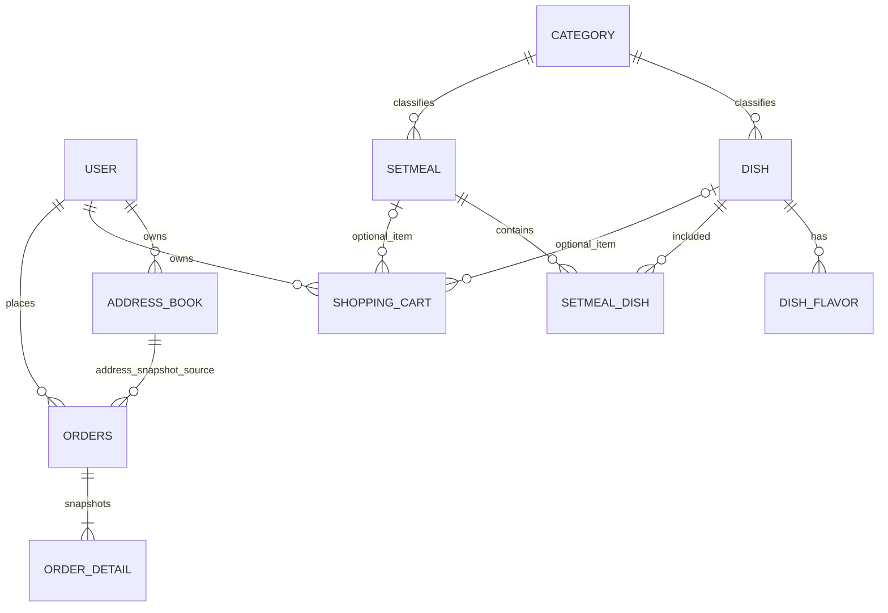

# 第2周：数据库设计与完整数据字典

编写人：刘晟玺。适用：当前交付的 Java/MyBatis 后端。此文档和 SQL 是设计产出，未在现有数据库执行建表或迁移。

## 1. 设计边界与实现约束

- MySQL 8.0.16+，InnoDB、utf8mb4；金额使用 DECIMAL(10,2)，时间使用 DATETIME，主键 BIGINT 自增。
- 11 张业务表与 Entity/Mapper 字段一致；Java 驼峰属性通过 MyBatis 映射到下划线字段。
- 使用逻辑外键：参考实现先删除聚合主表、再清理子表，直接添加物理外键会改变删除行为；历史订单快照也不应因地址或菜品删除而消失。关联完整性由 Service 校验与事务维护。
- 地址默认唯一性、购物车相同商品与口味合并由 Service 维护。当前没有依靠数据库唯一约束保证多请求并发唯一，作为后续联调压测风险记录，不宣称已解决。
- 用户订单金额为实时商品单价乘数量；order_detail.amount 与 shopping_cart.amount 是单价，orders.amount 是总额。课程版不收打包与配送费。
- employee.password 为密码派生值，预留255字符；SQL不提供固定管理员口令。当前后端使用PBKDF2-HMAC-SHA256；course启动时仅在管理员不存在且提供COURSE_ADMIN_PASSWORD时创建，不覆盖已有账户。

## 2. ER 关系

图中关系为逻辑关系，购物车和明细的 dish_id/setmeal_id 必须二选一。员工通过 JWT 身份作为审计字段来源。

## 3. 数据字典

NULL/DEFAULT 与下述字段定义对应 schema.sql；无需前端填写的 ID、归属、审计和金额字段由后端确定。

### employee（员工）

| 数据库字段 | Java属性 | SQL定义 | 含义 |
| --- | --- | --- | --- |
| `id` | `id` | BIGINT NOT NULL AUTO_INCREMENT | 主键 |
| `username` | `username` | VARCHAR(64) NOT NULL | username |
| `name` | `name` | VARCHAR(64) NOT NULL | name |
| `password` | `password` | VARCHAR(255) NOT NULL | password |
| `phone` | `phone` | VARCHAR(32) NULL | phone |
| `sex` | `sex` | VARCHAR(2) NULL | sex |
| `id_number` | `idNumber` | VARCHAR(32) NULL | idNumber |
| `status` | `status` | INT NOT NULL DEFAULT 0 | status |
| `create_time` | `createTime` | DATETIME NULL DEFAULT CURRENT_TIMESTAMP | @JsonFormat(pattern = "yyyy-MM-dd HH:mm:ss") |
| `update_time` | `updateTime` | DATETIME NULL DEFAULT CURRENT_TIMESTAMP | @JsonFormat(pattern = "yyyy-MM-dd HH:mm:ss") |
| `create_user` | `createUser` | BIGINT NULL | createUser |
| `update_user` | `updateUser` | BIGINT NULL | updateUser |

约束/索引：`UNIQUE KEY uk_employee_username (username)`；`CONSTRAINT ck_employee_status CHECK (status IN (0,1))`。

### user（用户）

| 数据库字段 | Java属性 | SQL定义 | 含义 |
| --- | --- | --- | --- |
| `id` | `id` | BIGINT NOT NULL AUTO_INCREMENT | 主键 |
| `openid` | `openid` | VARCHAR(128) NOT NULL | 微信用户唯一标识 |
| `name` | `name` | VARCHAR(64) NULL | 姓名 |
| `phone` | `phone` | VARCHAR(32) NULL | 手机号 |
| `sex` | `sex` | VARCHAR(2) NULL | 性别 0 女 1 男 |
| `id_number` | `idNumber` | VARCHAR(32) NULL | 身份证号 |
| `avatar` | `avatar` | VARCHAR(512) NULL | 头像 |
| `create_time` | `createTime` | DATETIME NULL DEFAULT CURRENT_TIMESTAMP | 注册时间 |

约束/索引：`UNIQUE KEY uk_user_openid (openid)`。

### category（分类）

| 数据库字段 | Java属性 | SQL定义 | 含义 |
| --- | --- | --- | --- |
| `id` | `id` | BIGINT NOT NULL AUTO_INCREMENT | 主键 |
| `type` | `type` | INT NOT NULL | 类型: 1菜品分类 2套餐分类 |
| `name` | `name` | VARCHAR(64) NOT NULL | 分类名称 |
| `sort` | `sort` | INT NOT NULL DEFAULT 0 | 顺序 |
| `status` | `status` | INT NOT NULL DEFAULT 0 | 分类状态 0标识禁用 1表示启用 |
| `create_time` | `createTime` | DATETIME NULL DEFAULT CURRENT_TIMESTAMP | 创建时间 |
| `update_time` | `updateTime` | DATETIME NULL DEFAULT CURRENT_TIMESTAMP | 更新时间 |
| `create_user` | `createUser` | BIGINT NULL | 创建人 |
| `update_user` | `updateUser` | BIGINT NULL | 修改人 |

约束/索引：`UNIQUE KEY uk_category_type_name (type,name)`；`KEY idx_category_type_status_sort (type,status,sort)`；`CONSTRAINT ck_category_type CHECK (type IN (1,2))`；`CONSTRAINT ck_category_status CHECK (status IN (0,1))`。

### dish（菜品）

| 数据库字段 | Java属性 | SQL定义 | 含义 |
| --- | --- | --- | --- |
| `id` | `id` | BIGINT NOT NULL AUTO_INCREMENT | 主键 |
| `name` | `name` | VARCHAR(64) NOT NULL | 菜品名称 |
| `category_id` | `categoryId` | BIGINT NOT NULL | 菜品分类id |
| `price` | `price` | DECIMAL(10,2) NOT NULL | 菜品价格 |
| `image` | `image` | VARCHAR(512) NULL | 图片 |
| `description` | `description` | VARCHAR(512) NULL | 描述信息 |
| `status` | `status` | INT NOT NULL DEFAULT 0 | 0 停售 1 起售 |
| `create_time` | `createTime` | DATETIME NULL DEFAULT CURRENT_TIMESTAMP | createTime |
| `update_time` | `updateTime` | DATETIME NULL DEFAULT CURRENT_TIMESTAMP | updateTime |
| `create_user` | `createUser` | BIGINT NULL | createUser |
| `update_user` | `updateUser` | BIGINT NULL | updateUser |

约束/索引：`KEY idx_dish_category_status (category_id,status)`；`CONSTRAINT ck_dish_price CHECK (price >= 0)`；`CONSTRAINT ck_dish_status CHECK (status IN (0,1))`。

### dish_flavor（菜品口味）

| 数据库字段 | Java属性 | SQL定义 | 含义 |
| --- | --- | --- | --- |
| `id` | `id` | BIGINT NOT NULL AUTO_INCREMENT | 主键 |
| `dish_id` | `dishId` | BIGINT NOT NULL | 菜品id |
| `name` | `name` | VARCHAR(64) NOT NULL | 口味名称 |
| `value` | `value` | VARCHAR(512) NOT NULL | 口味数据list |

约束/索引：`KEY idx_flavor_dish (dish_id)`。

### setmeal（套餐）

| 数据库字段 | Java属性 | SQL定义 | 含义 |
| --- | --- | --- | --- |
| `id` | `id` | BIGINT NOT NULL AUTO_INCREMENT | 主键 |
| `category_id` | `categoryId` | BIGINT NOT NULL | 分类id |
| `name` | `name` | VARCHAR(64) NOT NULL | 套餐名称 |
| `price` | `price` | DECIMAL(10,2) NOT NULL | 套餐价格 |
| `status` | `status` | INT NOT NULL DEFAULT 0 | 状态 0:停用 1:启用 |
| `description` | `description` | VARCHAR(512) NULL | 描述信息 |
| `image` | `image` | VARCHAR(512) NULL | 图片 |
| `create_time` | `createTime` | DATETIME NULL DEFAULT CURRENT_TIMESTAMP | createTime |
| `update_time` | `updateTime` | DATETIME NULL DEFAULT CURRENT_TIMESTAMP | updateTime |
| `create_user` | `createUser` | BIGINT NULL | createUser |
| `update_user` | `updateUser` | BIGINT NULL | updateUser |

约束/索引：`KEY idx_setmeal_category_status (category_id,status)`；`CONSTRAINT ck_setmeal_price CHECK (price >= 0)`；`CONSTRAINT ck_setmeal_status CHECK (status IN (0,1))`。

### setmeal_dish（套餐菜品关系）

| 数据库字段 | Java属性 | SQL定义 | 含义 |
| --- | --- | --- | --- |
| `id` | `id` | BIGINT NOT NULL AUTO_INCREMENT | 主键 |
| `setmeal_id` | `setmealId` | BIGINT NOT NULL | 套餐id |
| `dish_id` | `dishId` | BIGINT NOT NULL | 菜品id |
| `name` | `name` | VARCHAR(64) NOT NULL | 菜品名称 （冗余字段） |
| `price` | `price` | DECIMAL(10,2) NOT NULL | 菜品原价 |
| `copies` | `copies` | INT NOT NULL | 份数 |

约束/索引：`UNIQUE KEY uk_setmeal_dish (setmeal_id,dish_id)`；`KEY idx_sd_dish (dish_id)`；`CONSTRAINT ck_sd_copies CHECK (copies > 0)`。

### address_book（地址簿）

| 数据库字段 | Java属性 | SQL定义 | 含义 |
| --- | --- | --- | --- |
| `id` | `id` | BIGINT NOT NULL AUTO_INCREMENT | 主键 |
| `user_id` | `userId` | BIGINT NOT NULL | 用户id |
| `consignee` | `consignee` | VARCHAR(64) NOT NULL | 收货人 |
| `phone` | `phone` | VARCHAR(32) NOT NULL | 手机号 |
| `sex` | `sex` | VARCHAR(2) NULL | 性别 0 女 1 男 |
| `province_code` | `provinceCode` | VARCHAR(16) NULL | 省级区划编号 |
| `province_name` | `provinceName` | VARCHAR(64) NULL | 省级名称 |
| `city_code` | `cityCode` | VARCHAR(16) NULL | 市级区划编号 |
| `city_name` | `cityName` | VARCHAR(64) NULL | 市级名称 |
| `district_code` | `districtCode` | VARCHAR(16) NULL | 区级区划编号 |
| `district_name` | `districtName` | VARCHAR(64) NULL | 区级名称 |
| `detail` | `detail` | VARCHAR(255) NOT NULL | 详细地址 |
| `label` | `label` | VARCHAR(32) NULL | 标签 |
| `is_default` | `isDefault` | INT NOT NULL DEFAULT 0 | 是否默认 0否 1是 |

约束/索引：`KEY idx_address_user_default (user_id,is_default)`；`CONSTRAINT ck_address_default CHECK (is_default IN (0,1))`。

### shopping_cart（购物车）

| 数据库字段 | Java属性 | SQL定义 | 含义 |
| --- | --- | --- | --- |
| `id` | `id` | BIGINT NOT NULL AUTO_INCREMENT | 主键 |
| `name` | `name` | VARCHAR(64) NOT NULL | 名称 |
| `user_id` | `userId` | BIGINT NOT NULL | 用户id |
| `dish_id` | `dishId` | BIGINT NULL | 菜品id |
| `setmeal_id` | `setmealId` | BIGINT NULL | 套餐id |
| `dish_flavor` | `dishFlavor` | VARCHAR(512) NULL | 口味 |
| `number` | `number` | INT NOT NULL | 数量 |
| `amount` | `amount` | DECIMAL(10,2) NOT NULL | 金额 |
| `image` | `image` | VARCHAR(512) NULL | 图片 |
| `create_time` | `createTime` | DATETIME NULL DEFAULT CURRENT_TIMESTAMP | createTime |

约束/索引：`KEY idx_cart_user (user_id)`；`KEY idx_cart_item (user_id,dish_id,setmeal_id)`；`CONSTRAINT ck_cart_item CHECK ((dish_id IS NULL) <> (setmeal_id IS NULL))`；`CONSTRAINT ck_cart_number CHECK (number BETWEEN 1 AND 99)`；`CONSTRAINT ck_cart_amount CHECK (amount >= 0)`。

### orders（订单）

| 数据库字段 | Java属性 | SQL定义 | 含义 |
| --- | --- | --- | --- |
| `id` | `id` | BIGINT NOT NULL AUTO_INCREMENT | 主键 |
| `number` | `number` | VARCHAR(64) NOT NULL | 订单号 |
| `status` | `status` | INT NOT NULL DEFAULT 1 | 订单状态1待付款/2待接单/3已接单/4派送中/5已完成/6已取消 |
| `user_id` | `userId` | BIGINT NOT NULL | 下单用户id |
| `address_book_id` | `addressBookId` | BIGINT NOT NULL | 地址id |
| `order_time` | `orderTime` | DATETIME NOT NULL | 下单时间 |
| `checkout_time` | `checkoutTime` | DATETIME NULL | 结账时间 |
| `pay_method` | `payMethod` | INT NOT NULL | 支付方式 1微信，2支付宝 |
| `pay_status` | `payStatus` | INT NOT NULL DEFAULT 0 | 支付状态 0未支付 1已支付 2退款 |
| `amount` | `amount` | DECIMAL(10,2) NOT NULL | 实收金额 |
| `remark` | `remark` | VARCHAR(512) NULL | 备注 |
| `user_name` | `userName` | VARCHAR(64) NULL | 用户名 |
| `phone` | `phone` | VARCHAR(32) NULL | 手机号 |
| `address` | `address` | VARCHAR(512) NULL | 地址 |
| `consignee` | `consignee` | VARCHAR(64) NULL | 收货人 |
| `cancel_reason` | `cancelReason` | VARCHAR(255) NULL | 订单取消原因 |
| `rejection_reason` | `rejectionReason` | VARCHAR(255) NULL | 订单拒绝原因 |
| `cancel_time` | `cancelTime` | DATETIME NULL | 订单取消时间 |
| `estimated_delivery_time` | `estimatedDeliveryTime` | DATETIME NULL | 预计送达时间 |
| `delivery_status` | `deliveryStatus` | INT NULL | 配送状态  1立即送出  0选择具体时间 |
| `delivery_time` | `deliveryTime` | DATETIME NULL | 送达时间 |
| `pack_amount` | `packAmount` | INT NOT NULL DEFAULT 0 | 打包费 |
| `tableware_number` | `tablewareNumber` | INT NOT NULL DEFAULT 0 | 餐具数量 |
| `tableware_status` | `tablewareStatus` | INT NULL | 餐具数量状态  1按餐量提供  0选择具体数量 |

约束/索引：`UNIQUE KEY uk_orders_number (number)`；`KEY idx_orders_user_time (user_id,order_time)`；`KEY idx_orders_status_time (status,order_time)`；`CONSTRAINT ck_orders_status CHECK (status BETWEEN 1 AND 6)`；`CONSTRAINT ck_orders_pay CHECK (pay_status IN (0,1,2))`；`CONSTRAINT ck_orders_amount CHECK (amount >= 0)`。

### order_detail（订单明细）

| 数据库字段 | Java属性 | SQL定义 | 含义 |
| --- | --- | --- | --- |
| `id` | `id` | BIGINT NOT NULL AUTO_INCREMENT | 主键 |
| `name` | `name` | VARCHAR(64) NOT NULL | 名称 |
| `order_id` | `orderId` | BIGINT NOT NULL | 订单id |
| `dish_id` | `dishId` | BIGINT NULL | 菜品id |
| `setmeal_id` | `setmealId` | BIGINT NULL | 套餐id |
| `dish_flavor` | `dishFlavor` | VARCHAR(512) NULL | 口味 |
| `number` | `number` | INT NOT NULL | 数量 |
| `amount` | `amount` | DECIMAL(10,2) NOT NULL | 金额 |
| `image` | `image` | VARCHAR(512) NULL | 图片 |

约束/索引：`KEY idx_detail_order (order_id)`；`CONSTRAINT ck_detail_item CHECK ((dish_id IS NULL) <> (setmeal_id IS NULL))`；`CONSTRAINT ck_detail_number CHECK (number > 0)`；`CONSTRAINT ck_detail_amount CHECK (amount >= 0)`。

## 4. 状态、数据保护与验收

订单状态：1待付款 → 2待接单 → 3已接单 → 4派送中 → 5已完成；允许的取消流转进入6。支付状态0未支付、1已支付、2模拟退款；不得使用实体过时注释中的“7退款”作为订单状态。

下单在事务中完成归属校验、商品有效性校验、价格重算、订单及明细插入、清空购物车；支付和管理动作按当前状态更新，用户端不能完成配送。历史订单持有姓名、地址、手机号、菜品名称和单价快照。返回员工实体时排除密码，日志不输出密码与令牌。

初始化脚本只针对空库，不含DROP/ALTER，不应直接对既有库运行。种子包含两名虚构测试用户、两类分类、两道菜、一道套餐与两个地址；图片路径是待接入的素材路径，不宣称实际文件已存在。course profile测试登录应采用course:demo-user与course:demo-user-2标识。真实数据库兼容性、事务并发及种子导入须在授权的测试库单独验收。

营业状态保存在进程内存，默认1（营业），重启后重置；不作为第12张业务表，Redis不是课程主流程的运行前置。持久化营业状态属于后续改进。

## 5. 协作交接

刘晟玺提供本字典、SQL设计和第3周接口契约；钱文博据此使用ID与枚举，不直接连接数据库。字段变更先在契约与字典提议，经实际评审后同步后端和前端，不伪造双方确认记录。
